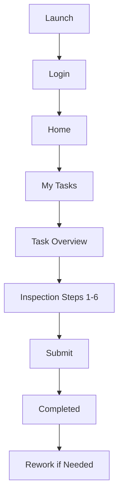
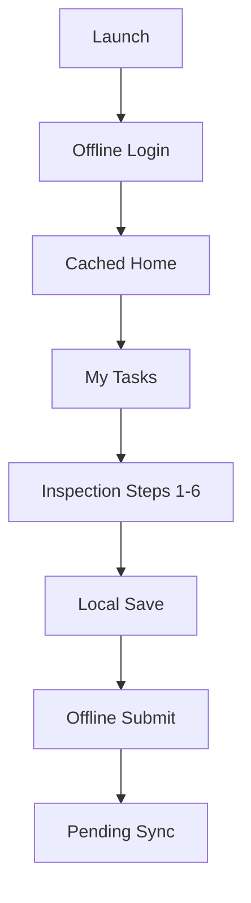

# iMAPS:FieldSync — Application Flow Guide

## 1. Application Journey Overview

### Launch
1. **Launch the App**: When the inspector launches the application, they are greeted with a **Splash Screen** that briefly displays the application logo and checks for an existing user session.

### Login
2. **Login**: Users navigate to the **Login Screen**, where they enter their email and password or use biometric authentication if set up. This is the main entry point into the application.

### Home
3. **Home Screen**: Once logged in, users land on the **Home Dashboard**, showcasing their upcoming inspections and various quick-access features. This is the central hub of the application.

### My Tasks
4. **My Tasks**: Users can navigate to the **My Tasks** section to review their assigned inspections. Tasks are organized by their status: Pending, Ongoing, and Completed.

### Task
5. **Task Overview**: Selecting a task leads the user to the task overview, where they can begin their inspection process, reviewing important details about the assigned inspection.

### Inspection Steps 1–6
6. **Inspection Steps**: Users follow a structured 6-step process to complete the inspection:
   - Site verification
   - GPS verification
   - Capturing photographic evidence
   - Completing a zoning checklist
   - Writing field findings
   - Reviewing & submitting the completed inspection

### Submit
7. **Submit**: After all steps are completed, users submit their findings. Successful submission marks the task as completed.

---

## 2. Online Flow

### 2.1 Launch / Splash Screen

**What you see**:
- The Splash Screen displays the **iMAPS:FieldSync** logo and version number at the center of the screen.
- The application checks for an active session.
- If there is an active session, it automatically transitions to the Home Dashboard.
### 2.2 Login Screen

**What you see**:
- Login Screen with fields for email and password, and an option to log in using biometrics (if enabled).
- A button for password recovery, a link to legal acknowledgement, and a connectivity status indicator.

**What you can do**:
- Enter your email and password, tap biometric login, or choose to recover your password if forgotten.
- Acknowledge Terms & Conditions if prompted.

### 2.3 Home Dashboard

**What you see**:
- A central screen displaying upcoming tasks, a live connectivity status, and a recent activity feed.

**What you can do**:
- Tap on any task to go to the My Tasks page or click on quick access features if available.

**Why it is there**:
- The Home Screen offers easy navigation to crucial application areas and informs users about their current tasks and activities without diving deeper.
### 2.4 My Tasks

**What you see**:
- A dashboard section with a list of tasks divided into Pending, Ongoing, and Completed categories. Each task shows its status and important details such as deadlines and tags.

**What you can do**:
- Filter tasks by category or search for specific tasks. Tap a particular task to view details and check off progress as you work on inspections.

**Why it is there**:
- The **My Tasks** section organizes inspections logically so users can quickly find and manage their work.

**What happens next**:
- Selecting a task brings you to the Task Overview page, where you can see specifics and start workflow steps.

### 2.5 Task Overview

**What you see**:
- Key details about the selected task including deadlines, location, assigned checklist items, and any photos previously taken.

**What you can do**:
- Review all task-related information, initiate inspection steps, and save findings as you progress through each stage.

**Why it is there**:
- This page provides inspectors with contextual information and instructions for the task they are undertaking, ensuring they understand what is required.

**What happens next**:
- As you progress through 6 inspection steps, this page updates to reflect completed actions and any additional findings.
**What happens next**:
### 2.6 Inspection Steps 1–6

**What you see**:
- A sequential navigation through defined inspection steps. Each step is clearly marked and often indicates completion status with visual progress markers.

**What you can do**:
- Follow through each inspection step, complete requirements such as checking GPS, capturing photographs, and filling out checklist items for zoning compliance.

**Why it is there**:
- Structured steps ensure that users follow a consistent inspection process, which is essential for compliance and thoroughness.

**What happens next**:
- After completing all steps, the app prompts to review the data and submit findings.
- Choose to navigate to **My Tasks** or move to other areas of the application like profile/settings as needed.
### 2.7 Submit

**What you see**:
- A summary of the collected inspection data ready for submission. This includes any findings and a selection of assessment results.

**What you can do**:
- Review all data inputs, select an assessment category (Compliant, With Discrepancy, etc.), and finalize the submission.

**Why it is there**:
- Providing a review screen allows inspectors to confirm the accuracy of their inputs before officially documenting the inspection.

**What happens next**:
- After submission, the task is moved to the **Completed Tasks** section if assessment criteria are met.

### 2.8 Completed Tasks

**What you see**:
- A list of tasks that have been submitted and are finalized, along with notable inspection summaries.

**What you can do**:
- Open completed inspections to review past work or address any necessary rework identified post-submission.

**Why it is there**:
- This allows for historical reference and potential re-inspections, which are important for accountability and follow-up tasks.

**What happens next**:
### 2.9 Rework Process

**What you see**:
- When opening a completed inspection for rework, previously saved data is displayed, allowing easy modification.

**What you can do**:
- Make changes to any part of the task and save the modified findings.

**Why it is there**:
- Allows inspectors to correct errors or incorporate new findings after the initial task submission.

**What happens next**:
- If data is changed and saved, the task is marked as **Modified** until it is resubmitted.
- Inspectors can choose to view details of each completed inspection and may initiate modifications if needed.
### 2.10 Upload & Sync

**What you see**:
- An indicator showing the sync status of your inspections, queued submissions, and any notifications of uploaded files.

**What you can do**:
- Monitor your upload progress and check for any actions that are pending synchronization.

**Why it is there**:
- The sync function ensures all locally saved inspections are consolidated back to the server, maintaining data integrity and security.

**What happens next**:
- Data marked for upload transitions from local storage to the server as soon as the internet connection is detected.
**Why it is there**:
### 2.11 Profile & Settings

**What you see**:
- A page comprised of user profile information, app settings, and help resources including the FAQs.

**What you can do**:
- Edit your profile, manage security settings, ask questions, or log out from your session.

**Why it is there**:
- This page centralizes user control over their account and provides access to critical help and support features.

**What happens next**:
- Changes made in profile settings take effect immediately and affect how the user interacts with app features.
- Secures access to the app by verifying the inspector’s identity and ensuring only authorized personnel can access inspection data.
### 2.12 Security Features

**What you see**:
- Security settings that inform the user about options such as biometric authentication and two-factor security measures.

**What you can do**:
- Enable or disable security features based on personal preference while also acknowledging legal terms and conditions.

**Why it is there**:
- These settings are critical in maintaining the application's integrity and protecting user data from unauthorized access.

**What happens next**:
- After configurations, users return to their regular tasks, assured of their account's security.

### 2.13 Common Questions (FAQ)

**What you see**:
- A Frequently Asked Questions section available for additional support to users who may have inquiries about the app's functionality.

**What you can do**:
- Review answers to common queries about tasks, delays in sync, and general use of the application.

**Why it is there**:
- This section is designed to reduce confusion by addressing common areas where users may need assistance.

**What happens next**:
### 2.14 Security in User Terms

**What you see**:
- Clear explanations of the application's security measures in a user-friendly format.

**What you can do**:
- Understand how your data is protected and the measures in place for a secure experience while using the app.

**Why it is there**:
- To reassure inspectors regarding the safety of their personal and inspection data during usage.

**What happens next**:
## 3. Offline Flow

### 3.1 Offline Login

**What you see**:
- The Login screen with a notification that indicates the device is offline.

**What you can do**:
- Authenticate using cached credentials if previously logged in.

**Why it is there**:
- To allow users to access the application even without an internet connection, facilitating inspections.

**What happens next**:
### 3.2 Home Dashboard (Offline)

**What you see**:
- A cached version of the Home dashboard with available inspections and offline indicators.

**What you can do**:
- View and select tasks to continue working on, even in offline mode.

**Why it is there**:
- Ensures that inspections can still proceed despite a lack of internet connectivity.

**What happens next**:
- Selecting a task routes you to the My Tasks view.
- Successful offline login leads to the Home Screen, which displays locally cached tasks.
### 3.3 Inspection Steps (Offline)

**What you see**:
- You will navigate through the familiar inspection steps, but the app indicates that some features may be limited.

**What you can do**:
- Conduct inspections by completing each required step and saving data locally.

**Why it is there**:
- This functionality allows inspectors to continue working on tasks despite no connectivity.

**What happens next**:
- Any data collected is saved temporarily until an internet connection is re-established.
- Users can continue to feel confident and informed about the measures in place to keep their information safe.
### 3.4 Submit Tasks (Offline)

**What you see**:
- The submission button will indicate that it is functioning but cannot connect until the device is online.

**What you can do**:
- Confirm that your input is saved and ready to submit when the internet connection is restored.

**Why it is there**:
- To enable seamless transition from work done offline to submitting data without losing progress.

**What happens next**:
- Upon reconnection, the submission will be automatically queued.
- Find clarity on issues before needing to reach out for further support.
### 3.5 Sync Center (Offline)

**What you see**:
- Sync status show pending submissions that are to be completed as soon as the app regains internet access.

**What you can do**:
- Check the status of your submissions that are waiting to sync.

**Why it is there**:
- This feature helps users track which tasks are pending submission and need attention after a connection is achieved.

**What happens next**:
- When back online, the app automatically syncs queued tasks, ensuring no data loss.
**What happens next**:
### 3.6 Profile & Settings (Offline)

**What you see**:
- Options to view your profile and settings, similar to online capabilities.

**What you can do**:
- Access and view your profile information, but changes may not be saved until you're online.

**Why it is there**:
- Accessibility of profile information is important for user continuity, even when off the network.

**What happens next**:
- Editing profile features requires you to be online to save any new updates.
- Successful login brings you to the Home Screen; if biometric login is successful, it takes you automatically to Home.
## 4. Online + Offline Flow

### 4.1 Starting Online
**What you see**:
- A fully functional application with access to all features and real-time updates.

**What you can do**:
- Log in, access the home dashboard, and view tasks as well as submit findings.

**Why it is there**:
- This illustrates the app's intended user experience when connectivity exists while ensuring smooth transitions.


**What you can do**:
### 4.2 Losing Internet Connection
**What you see**:
- A notification indicating that connectivity has been lost.

**What you can do**:
- Continue working offline, knowing your changes will be saved locally.

**Why it is there**:
- This ensures that users are aware of their offline status while still using the app.
- Wait for the automatic transition or tap to enter the login screen if no session is detected.

**Why it is there**:
- The Splash Screen serves to welcome users and initialize essential application services.

### 4.3 Working Offline
**What you see**:
- Access to locally cached data, allowing for continued inspections.

**What you can do**:
- Continue working on inspections and tasks as if you were online, with the knowledge that all data is stored securely until you reconnect.

**Why it is there**:
- This feature ensures that productivity remains uninterrupted even in the absence of an internet connection.
**What happens next**:
- If a session is detected, the app routes the user to the Home Screen. If not, the user signs in next.

### Completed
8. **Completed Tasks**: Users can view all completed tasks within **My Tasks**. Here, they can review submissions, but may also revisit them for any necessary rework.
### 4.4 Syncing After Reconnection
**What you see**:
- After re-establishing an internet connection, a prompt appears to sync your work.

**What you can do**:
- Click on the sync prompt to upload all queued data to the server automatically.

**Why it is there**:
- Enables users to ensure that their work is saved securely in the cloud immediately after reconnecting to the internet.

### Rework if Needed
9. **Rework Process**: If there are discrepancies or recommended changes, users can initiate the rework process to make adjustments to their submitted inspections.

### Sync When Necessary
### 4.5 Summary of Sync Center Interaction
**What you see**:
- An interface showing sync progress for all pending tasks upon reconnection.

**What you can do**:
- Monitor the completion of each task sync until all data is successfully uploaded.

**Why it is there**:
- Provides transparency about the syncing process, so users know the status of their uploads.
10. **Sync Center**: After connecting to the internet, any offline work is synchronized back to the server, ensuring all changes are updated in real-time.

### Profile / Settings
11. **Profile & Settings**: Users can manage their profile details and application settings from here, allowing for adjustments as needed.

## 5. Sync Center

### 5.1 Overview of the Sync Center
**What you see**:
- A dedicated section providing insights into your sync activities including pending, completed, and cached data.

**What you can do**:
- Review the sync status of submissions and any potential errors that need attention.

**Why it is there**:
- The Sync Center consolidates all information related to synchronization, ensuring users know which data has been successfully uploaded.

**What happens next**:
- Users can make informed decisions on whether to address any errors reported.
### 5.2 Using Sync Center
**What you see**:
- Sync status indicators showing uploads in progress and any issues requiring user action.

**What you can do**:
- Initiate manual synchronization if required or check status for pending uploads.

**Why it is there**:
- Gives users the option to manually intervene and manage sync processes if auto-sync fails or is needed.

**What happens next**:
- Once any manual sync operations are completed, the system updates the status accordingly.
**Mermaid Diagram:**
```mermaid
## 6. Profile

### 6.1 Managing Your Profile
**What you see**:
- Profile management section displaying user information and settings for each inspector.

**What you can do**:
- Update personal details, contact information, and preferences related to application use.

**Why it is there**:
- Ensures that users can keep their information current, facilitating better app management.

**What happens next**:
- Changes are reflected immediately in your app profile without the need for multiple actions.
### 6.2 Preferences and Settings
**What you see**:
- A section to adjust preferences including notification settings and security options.

**What you can do**:
- Choose notification preferences and set security options like enabling biometric access.

**Why it is there**:
- To allow users to customize the app according to their comfort and security needs.

**What happens next**:
- Any updates made are immediately applied, enhancing user personalization.
flowchart TD
    A[Launch] --> B[Login]
### 6.3 Help & Support
**What you see**:
- Access to FAQs and help documents that provide assistance and troubleshooting advice.

**What you can do**:
- Navigate through common questions and find solutions to issues you might encounter.

**Why it is there**:
- To provide immediate support and resources to users, fostering a more seamless experience with the app.
    B --> C[Home]
    C --> D[My Tasks]
    D --> E[Task Overview]
    E --> F[Inspection Steps 1-6]
    F --> G[Submit]
## 7. Security in User Terms

### 7.1 Secure Login
**What you see**:
- A login page requiring user credentials to access the application.

**What you can do**:
- Enter user credentials to log in.

**Why it is there**:
- To ensure that only authorized users can access sensitive inspection data.
    G --> H[Completed]
    H --> I[Rework if Needed]
    I --> J[Sync when Necessary]
### 7.2 Role-Based Access
**What you see**:
- Different permission levels displayed based on user role.

**What you can do**:
- Access features of the app as allowed by your role.

**Why it is there**:
- To ensure that each user can only see and do things relevant to their role, enhancing security.
    J --> K[Profile / Settings]
```

## 2. Online Flow

### 7.3 Encrypted Local Storage
**What you see**:
- Your inspection data securely stored on your device.

**What you can do**:
- Trust that your sensitive information is inaccessible to unauthorized users even if your device is lost or stolen.

**Why it is there**:
- To protect user data through secure encryption protocols.
### 2.1 Launch / Splash Screen
**What you see**:
- The Splash Screen displays the **iMAPS:FieldSync** logo and version number at the center of the screen.
- The application checks for an active session.
- If there is an active session, it automatically transitions to the Home Dashboard.
### 7.4 Private Photo Repository
**What you see**:
- All inspection-related photos saved privately and securely.

**What you can do**:
- Access your photos directly linked with inspections without concerns of exposure.

**Why it is there**:
- To ensure that sensitive site photographs remain confidential, serving only the user involved.

**What you can do**:
- Wait for the automatic transition or tap to enter the login screen if no session is detected.

**Why it is there**:
### 7.5 Secure Connection
**What you see**:
- A secure HTTPS connection is established during data transmission.

**What you can do**:
- Feel confident that all data communicated between the device and server is encrypted and secure.

**Why it is there**:
- To safeguard data integrity during exchanges, ensuring no third parties can intercept sensitive information.
- The Splash Screen serves to welcome users and initialize essential application services.

**What happens next**:
- If a session is detected, the app routes the user to the Home Screen. If not, the user signs in next.

### 7.6 Offline Protection
**What you see**:
- Your app operates securely even without internet access.

**What you can do**:
- Continue working on inspections as all data is temporarily secured locally.

**Why it is there**:
- Users must have a reliable environment for inspections where internet connectivity is sporadic or unavailable.
(Continue with each section of the app flow as outlined, especially detailing each interaction, the expected user actions, and corresponding app behavior.)
# iMAPS:FieldSync — Application Flow Guide

## 1. What iMAPS:FieldSync Does

### 7.7 Biometric Authentication
**What you see**:
- An option to log in securely using biometrics if this feature has been enabled.

**What you can do**:
- Access your application quickly and securely through fingerprint or facial recognition.

**Why it is there**:
- Provides an additional layer of security and convenience for accessing sensitive areas of the app.
iMAPS:FieldSync is a mobile tool designed for Municipal Planning and Development Office (MPDO) inspectors to perform zoning inspections on-site. It allows inspectors to:
- Receive and manage assigned inspections.
- Navigate to the parcels with live GPS and routing guidance.
- Perform standardized 6-step inspections with photo evidence and checklist verification.
- Work reliably even when offline by saving all work locally.
## 8. Quick Reference

| Page / Feature | What it is for | Important reminder |
|---|---|---|
| Login | Secure Access | Use your MPDO-registered credentials. |
| Home | Main Dashboard | View upcoming tasks and notifications. |
| My Tasks | Task Management | Identify tasks by status; completed tasks show in green. |
| Scheduling | Task Dates | Scheduling is only available while online. |
| Inspection Steps | Task Completion | Navigate through 6 defined steps. |
| GPS Verification | Location Accuracy | You must be within 30 meters of the site. |
| Photos | Evidence Capture | Photos save automatically with geotags. |
| Checklist | Compliance Checks | Complete all items for accurate evaluation. |
| Findings | Document Observations | Clearly state issues and recommendations. |
| Review & Submit | Submit Inspection | Confirm all data before submission. |
| Completed | Inspections Summary | View finalized reports and any required reworks. |
| Rework | Corrections | Adjust existing reports; does not mark task as modified until changes are made. |
| Sync Center | Data Sync | Check for pending syncs and upload statuses. |
| Profile | User Management | Manage account settings and preferences. |
| Security & Protection | App Safeguards | Review security options available for your profile. |
| Diagnostics & Support | Troubleshooting | Useful for common issues and FAQs. |
- Synchronize data to the cloud automatically once the internet connection is restored.

---

## 2. Online Flow

When connected to the internet, the app provides real-time updates and synchronization.

### 2.1 Open the App
Upon launch, the Splash Screen checks for an active session. If the user is logged in, it briefly initializes application services and routes to the Home Dashboard.
## 9. Complete Flow Diagram

### Online Flow


### Offline Flow


### Combined Online + Offline Flow
```mermaid
flowchart TD
## 10. Document Accuracy Rule
Review every section to ensure accuracy against the current implementation. Key points include:
- All features presented must be confirmed with the latest application version.
- No references to planned features or legacy behaviors that are not supported in the current app.
- Any discrepancies must be noted with a footnote to clarify documentation validity.
    A[Online Work] --> B[Connection Lost]
    B --> C[Offline Work]
    C --> D[Local Save]
    D --> E[Reconnect]
    E --> F[Automatic Sync]
    F --> G[Sync Center]
    G --> H[Cloud Updated]
```

### 2.2 Login & Authentication
Inspector logs in using their email and passcode. First-time or session-restored users can enable biometric login for faster subsequent access. A mandatory Terms & Privacy acknowledgement must be accepted.

### 2.3 Home
The main dashboard for the inspector, featuring:
- Upcoming tasks.
- Live connectivity status.
- Recent activity feed documenting all actions taken.

### 2.4 My Tasks
Tasks are organized into tabs:
- **Pending**: New or scheduled tasks.
- **Ongoing**: Inspections in progress.
- **Completed**: Finalized and submitted inspections.

### 2.5 Inspection Steps
The core 6-step workflow:
1. **Site Verification**: Map-based parcel navigation with road routes.
2. **GPS Verification**: Probing on-site position relative to parcel boundary.
3. **Photographic Evidence**: Geotagged site photography.
4. **Zoning Checklist**: Zoning compliance verification.
5. **Field Findings**: Observations, discrepancies, and recommendations.
6. **Review & Submit**: Summary check and final submission.

### 2.6 Submit
The inspector reviews the finalized report summary and categorizes the inspection (e.g., Compliant, With Discrepancy). Submission moves the task to the **Completed** tab.

---

## 3. Offline Flow

When internet connectivity is lost, the app remains fully functional for inspection tasks.

- **Local Persistence**: All input, photos, findings, and GPS records are saved to an encrypted local database.
- **Reliability**: Inspection steps continue without interruption. The app tracks progress and allows the inspector to resume from where they left off.
- **Sync Queueing**: Actions like completing a step or submitting a report are queued in the internal outbox (`pending_actions` table) and waiting for a reconnection.
- **Online-Only Restrictions**: Some tasks, such as scheduling a visit, currently require an active internet connection.

---

## 4. Online & Offline Flow Synchronization

The app employs a "Local-First → Cloud-Later" synchronization strategy.

1. **Internet Disappears**: The app detects the change and switches to offline mode.
2. **Offline Work**: The inspector continues the work, which is securely saved locally.
3. **Data Protection**: Local work is marked as pending synchronization.
4. **Internet Returns**: The app detects the connection and automatically activates the Sync Outbox engine.
5. **Syncing**: The Sync Center processes pending actions in the order they were performed.
6. **Completion**: Once synchronized with the server, the task is marked as updated, and the outbox entry is cleared.

---

## 5. Rework Flow

Completed inspections can be reopened for corrections.

1. Inspector selects a completed task and taps **Rework this step** on the chosen step card.
2. The specific step screen opens with saved data prefilled.
3. If changes are saved, a **Modified** tag appears on the task.
4. The inspector re-submits the task, which updates the record and clears the Modified tag.

---

## 6. Security in Simple Terms

Think of FieldSync like a secure digital office:

- **Login**: The main security door.
- **Role/Authorization**: Your digital ID card, ensuring you only see what you are assigned.
- **Encrypted Local Storage**: A locked, high-security filing cabinet on your device (even if the device is lost, data is unreadable without the key).
- **Private Photo Repository**: A secure, private photo archive.
- **HTTPS**: A protected transmission road for data traveling between the device and the server.

---

## 7. Quick Reference for Inspectors

| Feature | Purpose | Key Reminder |
|---|---|---|
| **Login** | Secure Access | Use your MPDO-registered credentials. |
| **Tasks** | View Jobs | Colors show urgency; Green means Completed. |
| **Site Verification** | Reach Site | Follow the map; wait for OSRM route. |
| **Compass** | Position Guidance | Keep proximity within 30 meters. |
| **Photos** | Evidence | Photos save automatically with geotagging. |
| **Sync Center** | Data Health | Check here if you have many pending syncs. |
| **Rework** | Revisions | Use only for corrections after submission. |

---

## 8. Common Questions (FAQ)

**Q: Why is my task blue?**
A: It is normal; work is not yet urgent.

**Q: What does 'Modified' mean?**
A: You’ve made corrections to a completed inspection that haven't been resubmitted yet.

**Q: Can I keep working without internet?**
A: Yes, the app saves everything on your device securely until you regain internet access.

---

## 9. English + Tagalog

(English)
**Pending** — Work that has not started yet.

(Tagalog)
**Pending** — Dito makikita ang mga task na hindi pa nasisimulan.
